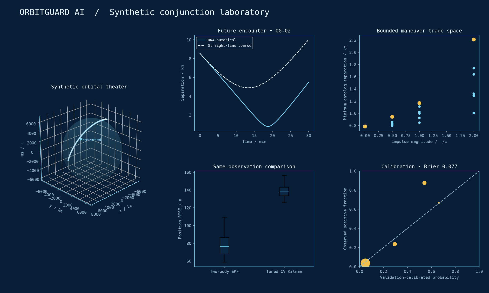
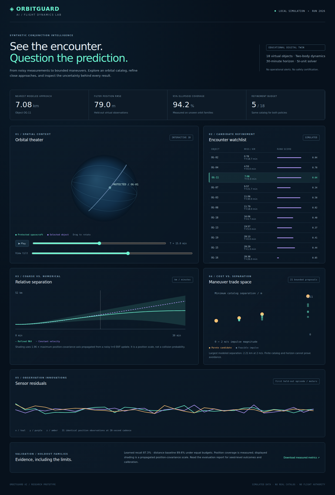

<div align="center">

# 🛰️ ORBITGUARD AI 🛰️
### 3D Orbital Conjunction Analysis, State Estimation & Avoidance Maneuver Workbench

[](https://github.com/mirmoosa1014-rgb/orbitguard-ai/actions/workflows/ci.yml)
[](https://python.org)
[](https://react.dev)
[](https://typescriptlang.org)
[](#explore-the-workbench)
[](https://github.com/TheRollerBlader/motion-graphic-style-library)
[](LICENSE)

</div>

---

# Problem Statement

**Can a small learned ranker identify synthetic orbital encounters worth refining, and how much does numerical propagation change a coarse prediction?** OrbitGuard AI connects noisy position measurements, uncertainty-aware state estimation, candidate ranking, and bounded maneuver comparisons in a local engineering workbench.

Inputs are generated Earth-centered inertial position/velocity states and virtual position observations. Outputs are propagated trajectories, estimator errors, ranked candidates, and a maneuver cost/separation trade space. Success means conserving two-body invariants, measuring errors on disjoint orbit families, and comparing recall at the same five-candidate budget. There is no presumption that ML wins.



*Analysis figure generated from [saved experiment outputs](results/), not an app screenshot.*



[Historical pre-Blueprint mobile screenshot](docs/images/app-mobile.png) · [Short numerical encounter animation](docs/images/encounter.gif)

## Explore the workbench

A rotatable, animated **3D orbital theater** shares a time scrubber with encounter plots. Select an object to inspect coarse versus numerical separation and closest-approach time. The UI displays measured estimator quality, virtual sensor residuals, ranking scores, and the maneuver Pareto frontier. No account, paid API, GPU or live catalog is needed.

## Start locally

Python 3.11+ and Node 24. Dependency installation requires network access once; all experiments and demo behavior then work offline.

```bash
python3 -m venv .venv
source .venv/bin/activate
python -m pip install -r requirements.txt
python -m orbitguard.experiment --full
python -m orbitguard.visuals
python -m uvicorn orbitguard.api:app --host 127.0.0.1 --port 8102
```

In a second terminal:

```bash
cd frontend
npm ci
npm run dev
```

After installation, `./run.sh` starts both processes. Open **http://127.0.0.1:5102**. The workbench reads checked-in demo outputs, so it also works without the API server. Read-only API endpoints: `/api/health`, `/api/demo`, `/api/metrics`, `/api/scenario?seed=2026`. No flight commands, uploaded models or external catalog access.

## Measured findings

Full run: 30 training episodes, 5 validation/calibration episodes, 15 held-out test episodes; 18 objects each, 30-minute horizon, five refinements per ranking policy. Radius/inclination families are disjoint. The 10 km label is an **illustrative refinement threshold**, not a collision radius.

| Measure | Full bounded run |
| --- | ---: |
| Two-body EKF position RMSE | 78.99 m |
| Tuned CV Kalman position RMSE | 139.91 m |
| EKF closest-approach forecast absolute error | 65.31 m |
| CV closest-approach forecast absolute error | 3389.33 m |
| Nominal 95% position ellipsoid coverage | 94.19% |
| Distance baseline recall at budget 5 | 89.56% |
| Learned ranker recall at budget 5 | 87.33% |
| Validation-calibrated Brier score | 0.0771 |

**The learned ranker underperformed distance ranking.** Both policies refine the same catalog and use identical truth for evaluation. Both Kalman filters receive identical observations. CV acceleration process noise was tuned on validation over [.003, .3, 3, 10, 30] m/s², selecting 10 m/s² before testing. Closest-approach forecasts share the 600-second observation cutoff.

The seed-2026 future-encounter demonstration spans approximately **0.79–2.21 km** minimum catalog separation across 21 bounded impulse proposals. This is a deterministic comparison, not robust collision avoidance.

[Ranking CSV](results/ranking.csv) · [Estimator outcomes](results/estimation.csv) · [Maneuver results](results/maneuvers.csv) · [Full metrics](results/metrics.json)

## Reproduce and validate

```bash
python -m orbitguard.experiment          # quick mode
python -m orbitguard.experiment --full   # fuller bounded experiment
python -m orbitguard.visuals
python -m pytest -q
cd frontend && npm ci && npm run build
```

Optional browser smoke, with Vite running:

```bash
cd frontend && npx playwright install chromium && cd ..
node scripts/browser-smoke.cjs
```

Ten tests cover circular period/conservation, step convergence, covariance update, causality, bounds, replay/family isolation, learned inference/fallback, maneuver catalog consistency and in-process API integration. TypeScript checking and Vite build passed. See [validation status](docs/progress.md) for exact checks and remaining environment limits. The CI badge below reports hosted verification status.

## Scope and limits

- Two-body RK4 only; J2, drag, radiation pressure, real ephemerides and operational catalog ingestion are absent.
- Direct virtual Cartesian observations replace real radar/range/angle sensors: independent 80 m Gaussian noise per axis in an ideal ECI position sensor.
- Model generalization is measured only across a few synthetic radius/inclination families. Constant uncertainty is not an informative feature in this version.
- Maneuver proposals use known simulated initial states; estimator uncertainty is evaluated separately. The algorithm does not optimize robust safety under uncertainty.
- Forecast shading is a propagated primary-position covariance scale, not calibrated relative collision confidence. Twenty-second encounter sampling, finite horizon/catalog and omitted physics can miss conjunctions.
- Learned ranking is worse than the simple baseline. The system cannot authorize spacecraft maneuvers or provide real collision alerts.

## Technical notes

[Architecture](docs/architecture.md) · [Model card](docs/model.md) · [Evaluation](docs/evaluation.md) · [Plain-language explanation](docs/explain.md) · [90-second demo](docs/demo.md) · [Project summary](docs/project-summary.md)

Primary sources consulted: [NASA gravity and orbital mechanics](https://science.nasa.gov/learn/basics-of-space-flight/chapter3-3/), [NASA circular-motion equations](https://www.grc.nasa.gov/www/k-12/Numbers/Math/Mathematical_Thinking/field_equations.htm), [ESA Navipedia Kalman filter equations](https://gssc.esa.int/navipedia/index.php?title=Kalman_Filter). This educational implementation is not NASA/ESA mission software.

## 👨‍💻 Author & Lead Developer

**Moosa Mir** is the primary developer and creator of this project. Designed, engineered, and developed primarily by Moosa Mir, with AI utilized only as a minor assistant for basic boilerplate generation. All core orbital dynamics, Kalman filter state estimation, candidate ranking models, 3D celestial mechanics visualization, and maneuver Pareto optimization were directed and developed by Moosa Mir.

## Repository

[Source and releases](https://github.com/mirmoosa1014-rgb/orbitguard-ai) · [Continuous integration](https://github.com/mirmoosa1014-rgb/orbitguard-ai/actions)

## Visual design

The current frontend uses the Motion Graphic Style Library’s Blueprint drafting-sheet style. [Design/source/license mapping](docs/design.md) and [MIT attribution](THIRD_PARTY_NOTICES.md) document the adaptation. The historical UI screenshots above predate this restyle. Local browser launch is blocked by the Mac sandbox; the prepared Blueprint browser-verification workflow will capture real replacement desktop/mobile/reduced-motion images after it runs. The analysis figure and numerical GIF have been recolored from unchanged saved outputs. No scientific results changed.
